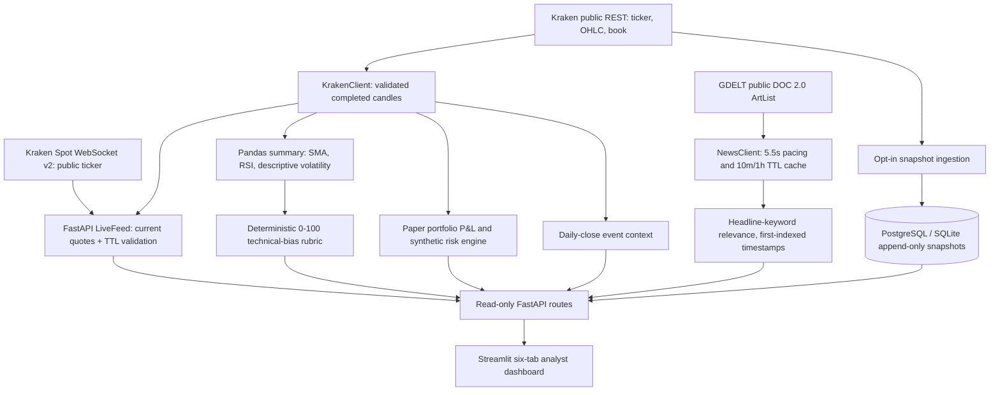

# Architecture — CryptoOps Sentinel v0.3

## Data flow

## Principles

- **No trading credentials, no order endpoints, no secrets**. Live quotes and historical candles come from Kraken public endpoints; the portfolio is wholly hypothetical.
- **Explicit provenance.** Each live quote specifies its provider, received time and price origin. REST fallback and WebSocket quotes have distinct percentage-change windows.
- **Recency checks.** WebSocket cache is valid for 45 seconds. REST backup results are cached for 15 seconds and never persisted as live account balances.
- **News limitations.** Only GDELT indexed articles returned by the provider are shown. The public API is rate-limited and limited to about 90 days for article lists. No empty result is asserted to mean no news happened.
- **Interpretability.** Indicator score lists component weights; the headline relevance heuristic lists keyword categories. Neither is a calibrated probability.
- **Historical event context.** Adjacent completed daily-close changes around user-selected dates are descriptive associations, not causal effects. Event timestamp vs news index time may differ.
- **Testability.** Unit tests use mock HTTP transports, deterministic price samples and mock websocket frames. A separate manual integration smoke test is required for Kraken/GDELT connectivity and Streamlit visuals.
- **Local-only deployment.** Demo DB credentials, unauthenticated dashboard and open local ports are not production-ready.

## Architectural trade-offs and future work

- Streamlit refreshes every five seconds, rather than displaying every incoming WebSocket tick. A low-latency trading terminal would require a dedicated push-based frontend.
- Live watchlists are per-user in-memory Streamlit state. A shared user-account settings database is intentionally omitted.
- GDELT makes no promise of a stable open historical archive. For longer event studies, use a provider with licensed archives and store source metadata consistently.
- Historical Spot candles from Kraken are capped at 720 observations per interval; long intraday history would require a separate persisted ingestion pipeline.
- The bias indicator has not been validated using out-of-sample forecasting accuracy or strategy execution costs. Calibrate or remove trade-ish names before using it for actual financial decisions.
